<p align="center">
  
</p>

<h1 align="center">DX11on10</h1>

<p align="center">
  <b>Run DirectX 11 games on DirectX 10 graphics cards.</b><br>
  A drop-in <code>d3d11.dll</code> that translates what DirectX 11 games ask for into something a 2007–2010 GPU can draw,<br>
  plus a one-click Windows app that installs it per game, safely.
</p>

<p align="center">
  
  
  
  
  
  
  
</p>

<p align="center">
  <a href="#the-app">The app</a> ·
  <a href="#how-it-works">How it works</a> ·
  <a href="#compute-shaders-without-compute-hardware">Compute replay</a> ·
  <a href="#compatibility">Compatibility</a> ·
  <a href="#building">Build</a> ·
  <a href="#the-test-lab">Test lab</a> ·
  <a href="#faq">FAQ</a>
</p>

<table>
  <tr>
    <td width="33%">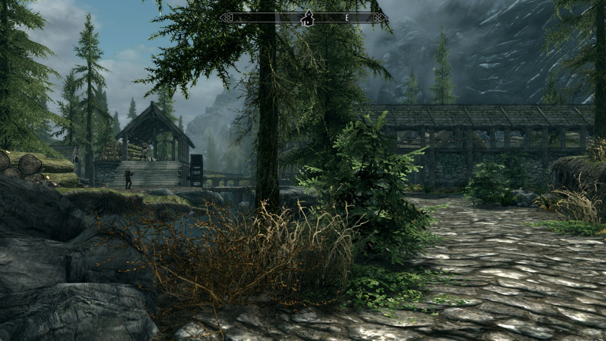</td>
    <td width="33%">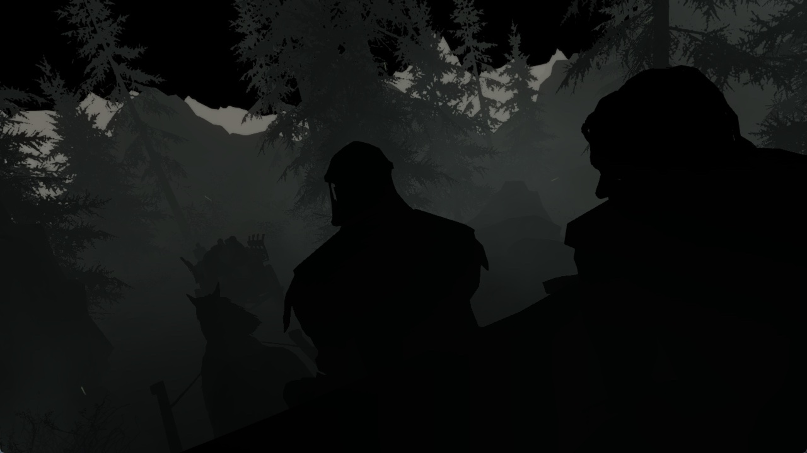</td>
    <td width="33%">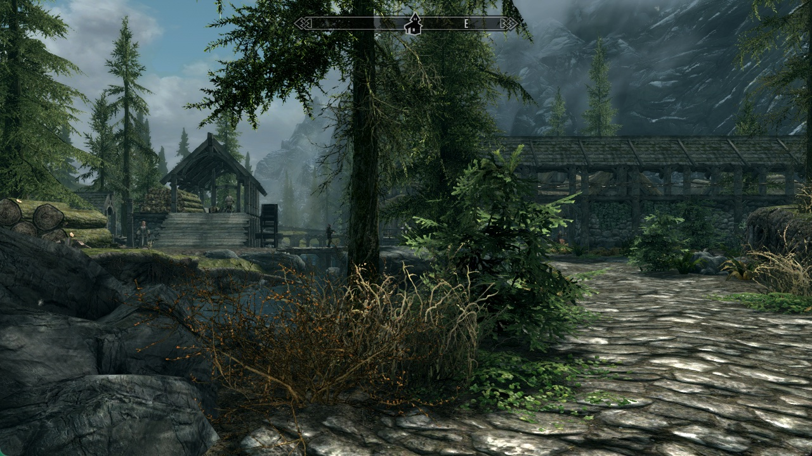</td>
  </tr>
  <tr>
    <td align="center"><b>Native DirectX 11</b><br><sub>the reference</sub></td>
    <td align="center"><b>DX10.1, compute skipped</b><br><sub>an early build: every lit surface goes black</sub></td>
    <td align="center"><b>DX10.1 through DX11on10</b><br><sub>automatic, no game-specific code</sub></td>
  </tr>
</table>

<p align="center"><sub>The Elder Scrolls V: Skyrim Special Edition (DirectX 11 only). Left and right: Riverwood, same spot, same settings, 1280×720.</sub></p>

---

## Contents

- [Why this exists](#why-this-exists)
- [At a glance](#at-a-glance)
- [Quick start](#quick-start)
- [The app](#the-app)
- [How it works](#how-it-works)
  - [Architecture](#architecture)
  - [Making the game believe it got DirectX 11](#making-the-game-believe-it-got-directx-11)
  - [Shader Model 5 → 4](#shader-model-5--4)
  - [Compute shaders without compute hardware](#compute-shaders-without-compute-hardware)
  - [Read-only depth buffers](#read-only-depth-buffers)
  - [Hooks: patch the device, wrap the context](#hooks-patch-the-device-wrap-the-context)
- [Compatibility](#compatibility)
- [Performance](#performance)
- [Configuration](#configuration)
- [Building](#building)
- [The test lab](#the-test-lab)
- [Engineering notes](#engineering-notes)
- [Project layout](#project-layout)
- [Roadmap](#roadmap)
- [FAQ](#faq)
- [Third-party code](#third-party-code)

---

## Why this exists

Every Direct3D 11 game creates its device with a list of **feature levels**: the GPU generations it accepts.
Many games list only `11_0`, or list `10_x` too but then refuse to start when they get it. On a DirectX 10
card (GeForce 8/9/200, Radeon HD 2000–4000, Intel HD 2000/3000) the result is the same: the game exits,
often silently, even though the card could draw most of what the game needs.

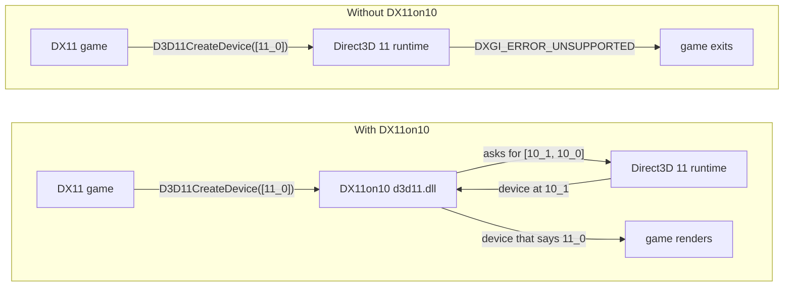

Telling the game "you got 11_0" is the easy part. After that the game uses Shader Model 5, compute
shaders, unordered access views and read-only depth views, none of which exist at feature level 10.
DX11on10 converts, emulates or quietly drops each of them. Visual fidelity comes second; **running at
all** comes first.

## At a glance

| | |
|---|---|
| **Game-specific code** | none: every fix is generic and switched on automatically |
| **Skyrim Special Edition** (DX11-only) | runs at feature level 10.1; 8,038 Shader Model 5 shaders converted, 0 draws skipped, its compute work replayed |
| **Compute shaders** | replayed as pixel- or geometry-shader draws; 11/11 test shaders **bit-exact** against real DX11 compute |
| **Reference test app** (`dx11test`) | **pixel-identical** to native DX11 at 10_1 (64-bit) and 10_0 (32-bit) |
| **Games** | 32-bit and 64-bit; all 51 `d3d11.dll` exports forwarded |
| **The app** | finds Steam, GOG and Epic games, installs per game with undo, and asks before risky steps |
| **Size** | about 10,500 lines of C++; one portable `DX11on10.exe` (7.4 MB) with both DLL builds inside |

> [!IMPORTANT]
> So far everything has been tested in a Windows 11 VM (VMware SVGA 3D, capped at feature level 10.1 by
> the layer), not yet on a physical DirectX 10 card or on Windows 7. Reports from real hardware are the most
> valuable thing right now.

## Quick start

### With the app (recommended)

1. Run `DX11on10.exe` (no installer, no admin rights needed to start it).
2. Find your game in the list: Steam, GOG and Epic games show up by themselves; for anything else click
   **Add game** or drop the game's `.exe` on the window.
3. Flip the switch. Start the game as usual, or click **Play**.

Turning the switch off removes everything the app added and puts back anything it moved.

### By hand

1. Copy `d3d11.dll` (64-bit or 32-bit, matching the game) and `dx11on10.ini` next to the game's `.exe`.
2. Start the game. `dx11on10.log` appears next to the `.exe` and shows what was converted, emulated or skipped.

---

## The app

<p align="center">
  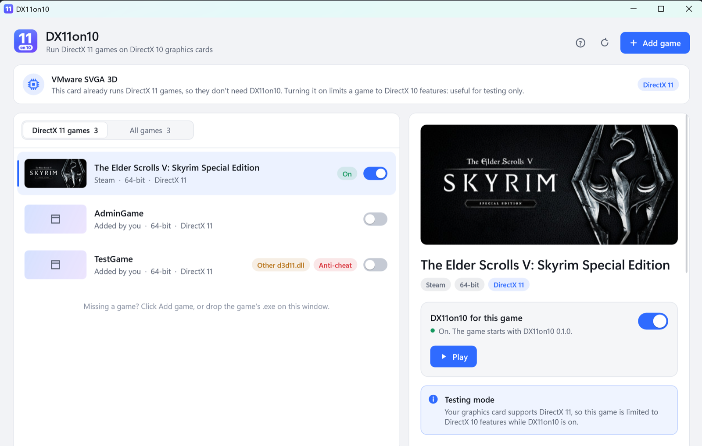
</p>

A native Win32 program drawn with Direct2D and DirectWrite: per-monitor DPI aware, follows the Windows
light/dark setting, runs on Windows 7 SP1 to 11, and carries both `d3d11.dll` builds inside itself.

<table>
  <tr>
    <td width="50%">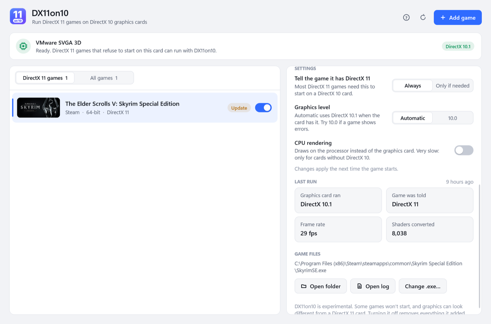</td>
    <td width="50%">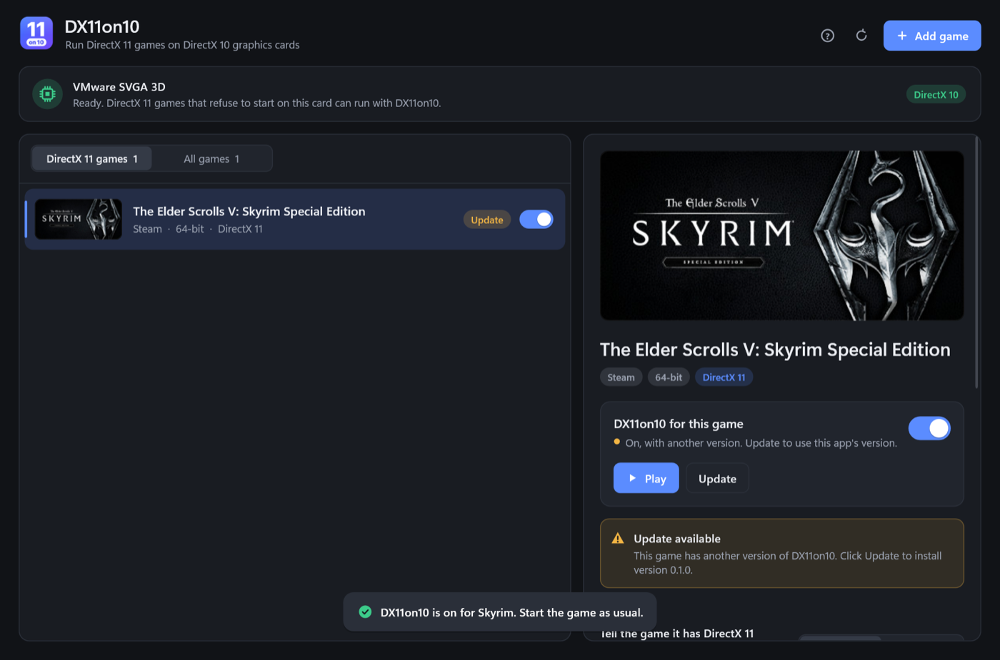</td>
  </tr>
  <tr>
    <td align="center"><sub>Per-game settings in plain words, and what the game's last start reported</sub></td>
    <td align="center"><sub>Dark mode, with an older layer version detected (one-click Update)</sub></td>
  </tr>
</table>

### What it does for each game

| | |
|---|---|
| **Finds games** | Steam (all libraries, with cover art), GOG (registry), Epic (launcher manifests), plus any `.exe` added or dropped |
| **Picks the right `.exe`** | ranks every `.exe` under the game folder: skips installers, crash reporters and launchers; reads PE import and delay-import tables of the `.exe` *and* the engine DLLs next to it (UnityPlayer.dll, …); falls back to scanning the code for `d3d11.dll` / `D3D11CreateDevice` strings |
| **Knows the API** | DirectX 9, 10, 11, 12, Vulkan or OpenGL, shown on every row |
| **Knows the CPU** | 32-bit or 64-bit `.exe` → matching `d3d11.dll`; ARM64 refused |
| **Turns on / off** | copies `d3d11.dll` + `dx11on10.ini`; removes them again; a failed step undoes the earlier ones |
| **Respects other mods** | another `d3d11.dll` (ReShade, ENBSeries, DXVK, Special K, dgVoodoo, 3DMigoto, …) is renamed to `d3d11.dll.dx11on10-backup` and restored on turn-off |
| **Handles protected folders** | only when a game folder needs it, an elevated copy of the app (`--ops`) performs the file steps |
| **Reads the last run** | the game's `dx11on10.log`: real vs reported feature level, frame rate, shaders converted, crashes, skipped effects |
| **Play** | `steam://rungameid/…`, the Epic launcher URI, or the `.exe` itself |

### Lifecycle of a game

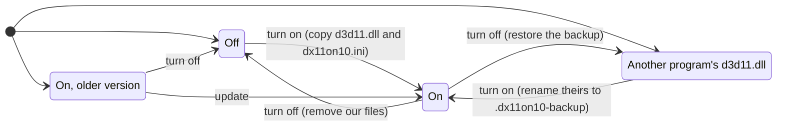

### A switch flip is a small transaction

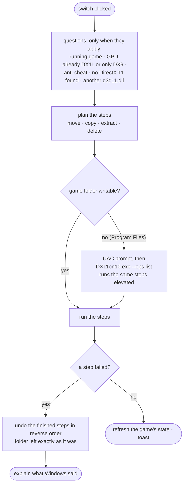

### Warnings that matter

<p align="center">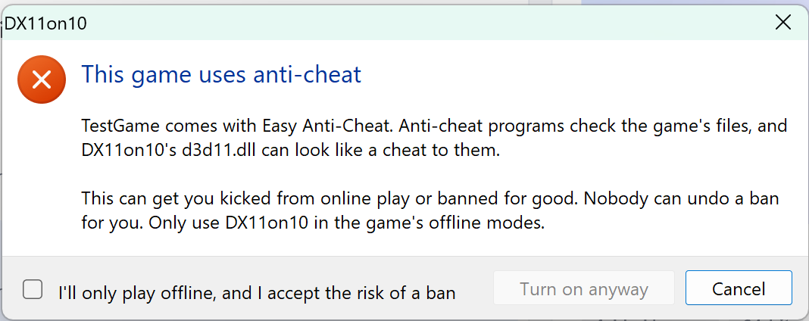</p>

| Situation | What the app does |
|---|---|
| **Anti-cheat** (Easy Anti-Cheat, BattlEye, XIGNCODE3, nProtect GameGuard, PunkBuster, EQU8, ACE, …) | red warning on the game; **Turn on anyway** stays disabled until *"I'll only play offline, and I accept the risk of a ban"* is ticked |
| Another `d3d11.dll` in the folder | names its owner, explains the rename and that it comes back on turn-off |
| A `dxgi.dll` mod | warns that it can stop the layer from working |
| The game doesn't use DirectX 11 | explains why it won't help (DX12/Vulkan) or isn't needed (DX9/10) |
| The game is running | refuses to touch its files; a 2-second watcher clears the state when it exits |
| The GPU already has DirectX 11 | "testing only" confirmation, with *Don't ask again* |
| The GPU only has DirectX 9 | explains that only CPU rendering (WARP) can work, very slowly |
| Last run crashed, refused, or drew nothing | tells you which setting to try, and where the log is |
| First start | a short notice that has to be read and accepted |

<details>
<summary><b>Keyboard, command line and files</b></summary>

| | |
|---|---|
| <kbd>↑</kbd> <kbd>↓</kbd> <kbd>Home</kbd> <kbd>End</kbd> | move through the list |
| <kbd>Space</kbd> | turn the selected game on or off |
| <kbd>F5</kbd> | look for games again |
| <kbd>Ctrl</kbd>+<kbd>O</kbd> | add a game |

| Command line | |
|---|---|
| `--report out.txt` | write everything the scan found (games, `.exe`, APIs, anti-cheat, state, notices) |
| `--screenshot out.png [--theme dark] [--select name] [--gpu 10_1] [--all] [--scroll N]` | render the window off-screen to a PNG (works over SSH) |
| `--toggle <name> out.txt` | turn a game on or off headlessly, answering every question "yes" (tests) |
| `--add <exe>` | add a game to the list |
| `--hits <file>` | write where every control is after each frame (for the GUI test robot) |
| `--ops <file>` | internal: the elevated helper |

App settings live in `%APPDATA%\DX11on10\settings.ini`; per-game layer settings in `dx11on10.ini` next to each game.

</details>

---

## How it works

### Architecture

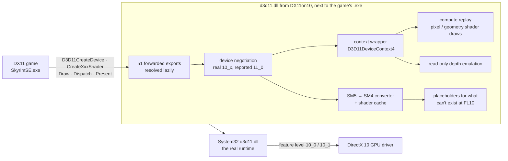

Windows looks for DLLs next to the `.exe` first, so a game that imports or loads `d3d11.dll` gets ours.
Ours loads the real one from `System32` by full path and forwards every export to it, intercepting the few
that matter. A log, a crash logger (vectored exception handler with a stack walk) and a stats line every
600 frames are built in.

### Making the game believe it got DirectX 11

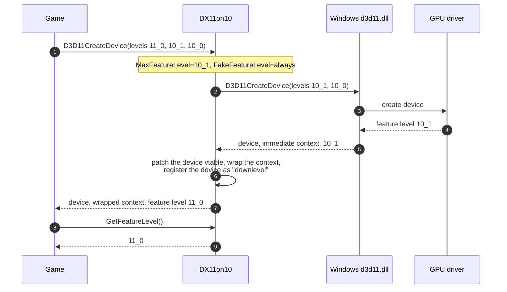

`FakeFeatureLevel=auto` only reports 11_0 when the game's list contains nothing at or below 10_1; `always` is
needed for games like Skyrim that list 10_x but quit when they get it.

### Shader Model 5 → 4

Every shader the game creates goes through `src/dxbc`: the DXBC container is parsed, the Shader Model 5
token stream is rewritten into Shader Model 4.0 or 4.1, signatures are fixed up, and the container is rebuilt
with a freshly computed checksum. Results are cached by bytecode hash, so a shader is converted once per run.

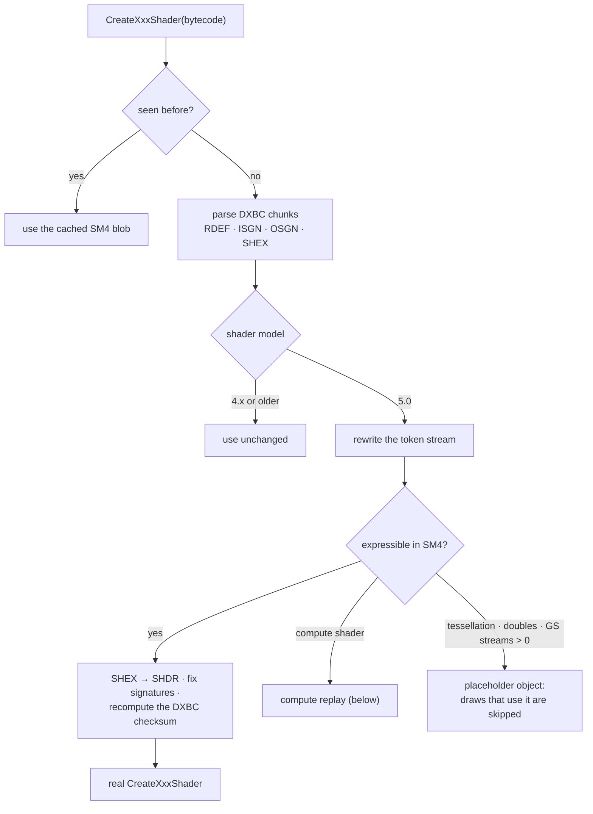

| Shader Model 5 feature | Strategy |
|---|---|
| Resource dimension / return type extended tokens | stripped (SM4 declares the same thing without them) |
| `rcp` | `div 1.0, x` |
| `deriv_rtx_coarse/fine`, `deriv_rty_coarse/fine` | plain `deriv_rtx` / `deriv_rty` |
| `SV_DepthGreaterEqual` / `SV_DepthLessEqual` (conservative depth) | `SV_Depth`, output signature renamed to match |
| `emit_stream` / `cut_stream` / `dcl_stream` on stream 0 | `emit` / `cut` |
| `eval_centroid`, `eval_sample_index`, `eval_snapped` | the interpolated input value |
| `bfi` (bit field insert) | emulated with shifts and masks: a constant-width fast path and a general path, verified bit-exact |
| 4.1 instructions (`lod`, `sample_info`, `sample_pos`, …) | kept at 10_1, refused at 10_0 |
| Hull and domain shaders (tessellation) | placeholder: the patch draws are skipped |
| Double precision, multiple GS streams | placeholder |

The DXBC checksum is MD5 with a non-standard final block (bit count in the first dword, `(bits >> 2) | 1` in
the last). The runtime rejects a container whose checksum doesn't match, so `src/dxbc/dxbc.cpp` reproduces it
exactly.

### Compute shaders without compute hardware

Feature level 10 has no compute shaders and no UAVs. Modern renderers use them for small but essential jobs:
copies, blurs, light culling. Skip them and whatever reads their output sees zeros. In Skyrim that was every
lit surface (the middle picture at the top). DX11on10 rewrites each `cs_5_0` program into draws that the
graphics pipeline *can* do, automatically.

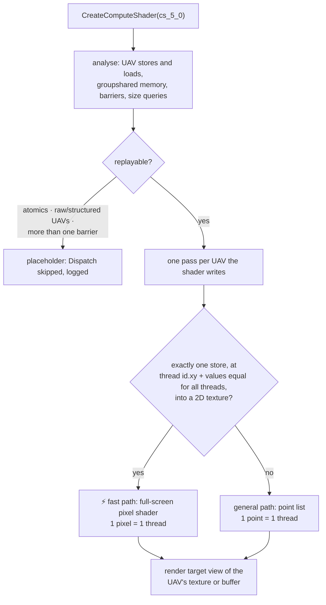

**General path.** A dispatch of N threads becomes `Draw(N)` with a point list. A generated geometry shader
*is* the compute shader: its prologue rebuilds `SV_DispatchThreadID`, `SV_GroupID`, `SV_GroupThreadID` and
`SV_GroupIndex` from the point number, the body runs unchanged, and every `store_uav_typed` becomes "emit a
point at that texel carrying that value". A tiny pixel shader writes the value into a render target view of
the UAV's resource.

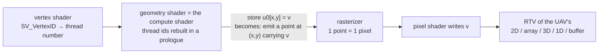

**Fast path.** When every thread writes exactly one texel at its own `(x, y)` plus an offset that is the same
for all threads, an affine analysis (which follows branches) proves it and the shader becomes a pixel shader
over a full-screen triangle: one pixel per thread, no geometry shader, no points. Same output, about twice
the speed in Skyrim.

<details>
<summary><b>What else the replay handles</b></summary>

- **Multiple and conditional stores**: one emitted point per store that actually executes; `ret`/`retc` keep working.
- **Reading the UAV it writes** (`ld_uav_typed`, read-modify-write): the shader reads a snapshot copy bound as a texture.
- **Size queries** (`resinfo`, `bufinfo`): answered from a constant buffer the layer fills per dispatch.
- **Groupshared memory** in the common "every thread stores its own slot, one barrier, then reads its
  neighbours" pattern (separable blurs): each read of a neighbour's slot inlines and recomputes the
  neighbour's producer code.
- **`DispatchIndirect`**: the arguments are read back, then replayed like a normal dispatch.
- **Typed buffers**, texture arrays (slice from the dispatch's z) and 3D textures.
- **State safety**: everything a replay touches is saved and restored: shaders and their resources, constant
  buffers and samplers, render targets, viewports, rasterizer, blend and depth state, input layout and topology.
- **Resource creation**: textures and typed buffers created with a UAV bind flag are re-created with a
  render-target bind instead, so the replay can draw into them.

</details>

<details>
<summary><b>The compute test suite: 11/11 bit-exact against real DX11 compute</b></summary>

`tools/computetest.sh` runs each test shader on a real DX11 device and through the layer at 10.1 on the same
GPU, then compares every byte of the output.

| Test | What it exercises | Replayed as |
|---|---|---|
| `copy` | Skyrim's region copy pattern | ⚡ pixel shader |
| `math` | per-pixel math with a filtered sample | ⚡ pixel shader |
| `two_stores` | two stores per thread | geometry shader |
| `conditional` | writes only some texels | ⚡ pixel shader |
| `uint` | integer output, `SV_GroupIndex` | ⚡ pixel shader |
| `array` | texture array, slice from the dispatch's z | geometry shader |
| `blur` | horizontal blur through groupshared memory (like Skyrim's) | geometry shader + recomputed reads |
| `size` | `GetDimensions` | ⚡ pixel shader |
| `blur_vertical` | vertical blur, groups along y | geometry shader + recomputed reads |
| `rmw` | read-modify-write of the output | ⚡ pixel shader + snapshot |
| `buffer` | typed buffer output | geometry shader |

</details>

### Read-only depth buffers

Deferred renderers bind the depth buffer read-only for depth testing while their shaders read the same
buffer as a texture. Feature level 10 has no read-only depth views; with a writable view bound, the runtime
silently unbinds the texture and lighting reads zeros.

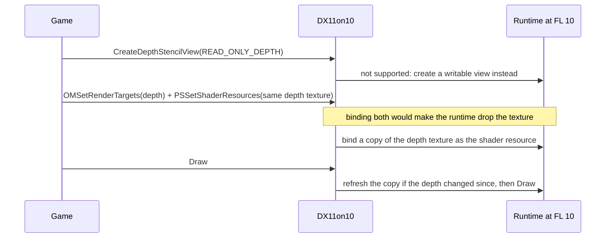

### Hooks: patch the device, wrap the context

| Object | Technique | Why |
|---|---|---|
| Device, DXGI factory, swap chain | **vtable patching** | every object of a class shares one vtable, so calls through any pointer are caught (`GetDevice()`, overlays, …) and object identity is untouched; also works for x64 games under emulation on ARM64 Windows |
| Device contexts | **wrapping** (a generated `ID3D11DeviceContext4`) | the D3D11 runtime keeps per-context vtables on the heap and rewrites their draw slots at run time, so patches there are silently undone |
| UAVs, unconvertible shaders | **placeholder objects** | the game gets a valid COM object; draws and dispatches that need it are skipped or replayed |

The context wrapper is generated from the C vtable in MinGW's `d3d11_3.h` (`tools/gen_context_wrapper.py`),
and vtable slot numbers are computed with `offsetof` in C (`src/proxy/slots.c`), so neither is maintained by
hand.

---

## Compatibility

| | |
|---|---|
| ✅ **Works** | feature level negotiation and reporting, SM5 vertex/pixel/geometry shaders, constant buffers, textures, samplers, render targets, flip and blit swap chains, 32-bit and 64-bit games |
| 🔁 **Emulated** | compute shaders (most common patterns), UAV-written textures and typed buffers, read-only depth views, `DispatchIndirect`, conservative depth, `bfi` |
| ⏭️ **Skipped, logged** | tessellation (hull/domain shaders), compute shaders with atomics or raw/structured UAVs, structured buffers in vertex/pixel shaders, double precision |
| ⛔ **Out of scope** | DirectX 12 and Vulkan games, games with anti-cheat (online bans), GPUs without DirectX 10 (CPU rendering via WARP works but is very slow) |

### Tested

| Title | Engine | Result |
|---|---|---|
| **The Elder Scrolls V: Skyrim Special Edition** | Creation Engine, DX11-only | ✅ runs at 10.1, Riverwood matches native DX11; 17 of its 19 compute shaders replayable (the 2 that aren't don't run in Riverwood); also started end-to-end from the app: **Play** → Steam → Skyrim's launcher → game |
| Twelve Minutes | Unity 2019.4, 32-bit | ✅ already runs on DX10 by itself; forced through the layer it is pixel-identical |
| `dx11test` (in this repo) | DX11-only test scene | ✅ pixel-identical at 10_1 (x64) and 10_0 (x86) |

### Hardware

DirectX 10 / 10.1 GPUs, for example GeForce 8, 9, 100, 200 and 300 series, Radeon HD 2000–4000, and Intel HD
Graphics 2000/3000. Windows 7 SP1 needs the Platform Update (KB2670838) and the Universal C Runtime
(KB2999226), which most updated systems already have.

## Performance

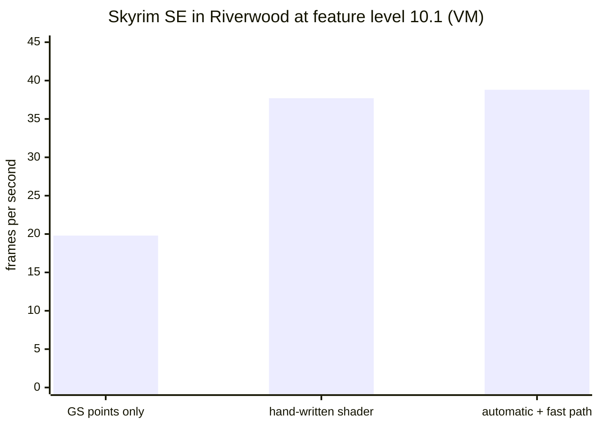

The automatic compute replay with the pixel-shader fast path is as fast as a shader written by hand for
Skyrim's copy, and twice as fast as replaying every compute thread as a geometry-shader point. Shader
conversion happens once per shader, at creation time, and is cached.

<sub>Windows 11 on ARM in VMware Fusion on an Apple M5 MacBook Air (VMware SVGA 3D); the 64-bit game runs under
Windows' x64 emulation. Averaged over a few hundred frames. Real DX10 hardware will differ.</sub>

## Configuration

`dx11on10.ini` next to the game (the app writes it for you):

| Key | Values | Default | Meaning |
|---|---|---|---|
| `MaxFeatureLevel` | `10_1`, `10_0`, `native` | `10_1` | highest real feature level; `native` = no cap (for comparisons) |
| `FakeFeatureLevel` | `always`, `auto`, `off` | `auto` (app: `always`) | report 11_0 to the game |
| `Translate` | `1`, `0` | `1` | `0` = only cap the level, behave like a plain DX10 card |
| `Driver` | `hardware`, `warp` | `hardware` | `warp` = Microsoft's CPU renderer |
| `DebugLayer` | `0`, `1` | `0` | D3D debug layer messages into the log (needs Windows "Graphics Tools") |
| `DumpShaders` | `0`, `1`, `2` | `0` | save every shader (1) or only unconvertible ones (2) to `dx11on10_shaders` |
| `Screenshots` | frame numbers | | save the back buffer of these frames, e.g. `100,500` |
| `ExitAfterFrame` | number | `0` | quit after this frame (automated tests) |

<details>
<summary><b>Developer options</b></summary>

| Key | Meaning |
|---|---|
| `Emulate=1` | treat a real feature level 11 device like a 10.x one (bisect layer bugs on a DX11 GPU) |
| `KeepCompute=1`, `KeepComputeIds=` | keep real compute shaders (all, or by id) while emulating |
| `TraceFrame=N` | log every call of frame N |

</details>

## Building

Everything cross-compiles on macOS or Linux with MinGW-w64; no Windows SDK or Visual Studio needed.

```sh
brew install mingw-w64        # or your distribution's mingw-w64 package
./build.sh                    # build/x64, build/x86 and build/app/DX11on10.exe
./build.sh x64                # one architecture
./build.sh app                # only the app (needs both DLLs built first)
```

| Output | |
|---|---|
| `build/x64/d3d11.dll`, `build/x86/d3d11.dll` | the layer (static CRT, version resource `ProductName=DX11on10`) |
| `build/app/DX11on10.exe` | the app: 32-bit, so one `.exe` serves 32-bit and 64-bit Windows; both DLLs embedded |
| `build/*/dx11test.exe`, `computetest.exe`, `shadertool.exe` | test programs |

The helper shaders the compute replay uses (`src/proxy/shaders/emulation.hlsl`) are compiled with `fxc` in
the Windows VM by `tools/build_emulation_shaders.sh` into `src/proxy/emulation_shaders.h`, which is checked in.

## The test lab

Development runs on a Mac; every test runs in a Windows 11 VM, driven over SSH.

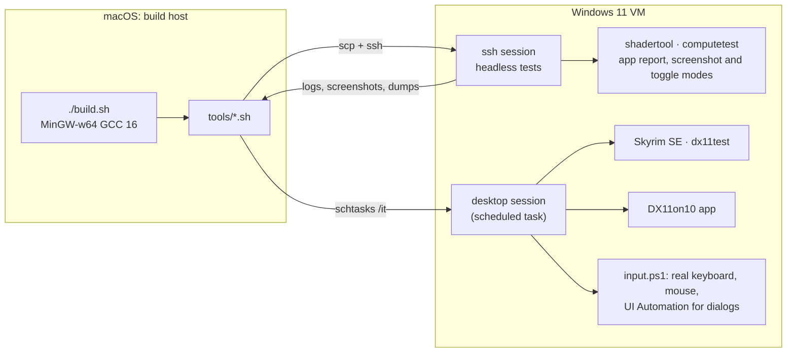

| Tool | What it proves |
|---|---|
| `tools/vmtest.sh` | `dx11test` native vs through the layer: screenshots, then `tools/compare.py` diffs them pixel by pixel |
| `shadertool roundtrip / compare / computegs / pstest` | one shader converted and validated on a real runtime with the debug layer; `compare` checks native and converted pixel shaders produce identical bits |
| `tools/computetest.sh` | the 11 compute tests, native vs replayed, byte for byte |
| `tools/skyrim.sh` | Skyrim in about 80 s: skips the intro, opens the console at the menu, `coc riverwood`, screenshots, log |
| `tools/gametest.sh` | any game: install the layer (or keep what the app installed), run, collect logs and screenshots |
| `tools/apptest.sh` | the app driven with the **real mouse**: it reports where each control is drawn (`--hits`), clicks dialog buttons found through UI Automation, types into the file picker; covers anti-cheat gating, backups, elevation, Steam **Play** → launcher → game |

## Engineering notes

A few things that were not obvious and cost real time:

- **The D3D11 runtime rewrites its own context vtables.** Patching `Draw` on the immediate context worked
  for the test app and silently did nothing in Skyrim: the runtime keeps per-context heap vtables and swaps
  their draw entries as state changes. Contexts are therefore wrapped, everything else is patched.
- **A VMware driver ignores pixel shaders that read undeclared input components.** The generated fast-path
  shader read `v0.xyzw` with only `v0.xy` declared; Microsoft's WARP accepted it, the VMware driver drew
  nothing. Generated shaders now read only what they declare. `shadertool pstest … hw|warp` found it.
- **Windows 7 compatibility hides in imports.** The crash logger used `GetCurrentThreadStackLimits`
  (Windows 8+), which would have stopped the DLL from loading on Windows 7 at all. Stack limits now come from
  the thread's TEB.
- **One context, many interfaces.** `GetImmediateContext`, `GetImmediateContext1/2/3` and `QueryInterface`
  return the same context under different interfaces; the layer keys its per-context state so all of them
  share it.
- **Skyrim exits silently** when it gets 10_1 although it lists 10_1. That is why the app defaults to
  `FakeFeatureLevel=always`.

## Project layout

```text
dx11on10/
├── src/
│   ├── dxbc/            DXBC container, checksum, SM5 → SM4 converter, compute → GS/PS rewriter (portable C++)
│   ├── proxy/           the d3d11.dll: exports, device, context wrapper, compute replay, depth, logging, crash logger
│   │   └── shaders/     HLSL for the replay's helper shaders (compiled into emulation_shaders.h)
│   └── common/          back-buffer capture, version
├── app/                 DX11on10.exe: Direct2D UI, game scanning, install/uninstall, warnings
│   └── res/             icon and logo (drawn by tools/make_icon.swift)
├── tests/
│   ├── dx11test/        a small DX11-only "game" used as the reference workload
│   ├── computetest/     compute shaders vs their replay, byte for byte
│   ├── shadertool/      convert / validate / compare single shaders
│   └── shaders/         test HLSL
├── tools/               VM drivers, game and app test scripts, code generators
├── docs/images/         README pictures
├── third_party/microsoft/   tokenized shader format header (NCSA licence)
├── dist/dx11on10.ini    documented default settings
└── build.sh
```

## Roadmap

- [ ] Run on real DirectX 10 hardware and on Windows 7
- [ ] More DX11-only games, especially Unreal Engine 4 and Unity titles
- [ ] BC6H / BC7 textures (decode at load: DX10 cards can't sample them)
- [ ] Structured buffers in vertex and pixel shaders, as typed buffers
- [ ] More SM5-only bit instructions: `countbits`, `firstbit_*`, `ubfe`/`ibfe`, `f16tof32`/`f32tof16`
- [ ] Compute replay for more groupshared patterns and simple atomics
- [ ] Installer and code signing for the app

## FAQ

<details>
<summary><b>Will Steam's "Verify integrity of game files" remove it?</b></summary>

No. Steam only checks the files that belong to the game; an extra `d3d11.dll` is left alone. If a game ever
ships its own `d3d11.dll`, verifying would restore that file, and the app would show the game as using
another program's `d3d11.dll` again.
</details>

<details>
<summary><b>Can I use it with online games?</b></summary>

Not with games that have anti-cheat. Anti-cheat checks the game's files and can treat any extra DLL as a
cheat. The app detects common anti-cheat systems and makes you confirm the risk explicitly.
</details>

<details>
<summary><b>How is this different from DXVK or dgVoodoo?</b></summary>

DXVK translates Direct3D to Vulkan, which DirectX 10 cards don't support. DX11on10 stays on Direct3D: it
uses the real Direct3D 11 runtime at feature level 10 and fills the gaps between what the game asks for and
what the card has.
</details>

<details>
<summary><b>Does it make games run on a DirectX 9 card?</b></summary>

Only with CPU rendering (`Driver=warp`), which works but is far too slow for most games. DX11on10 needs
Shader Model 4 hardware.
</details>

<details>
<summary><b>Something looks wrong or the game doesn't start. What helps?</b></summary>

`dx11on10.log` next to the game's `.exe` (the app's **Open log** button). It lists the feature levels the game
asked for and got, every shader that couldn't be converted, every skipped draw and dispatch, and a stack
trace if something crashed. Try **Graphics level 10.0** in the app, and attach the log to a report.
</details>

## Third-party code

`third_party/microsoft/d3d12TokenizedProgramFormat.hpp` is Microsoft's tokenized shader format header,
distributed under the University of Illinois/NCSA Open Source License (see `third_party/microsoft/LICENSE.TXT`).
DirectX, Direct3D and Windows are trademarks of Microsoft. The Elder Scrolls V: Skyrim is a trademark of
Bethesda Softworks; its screenshots here only demonstrate compatibility.
